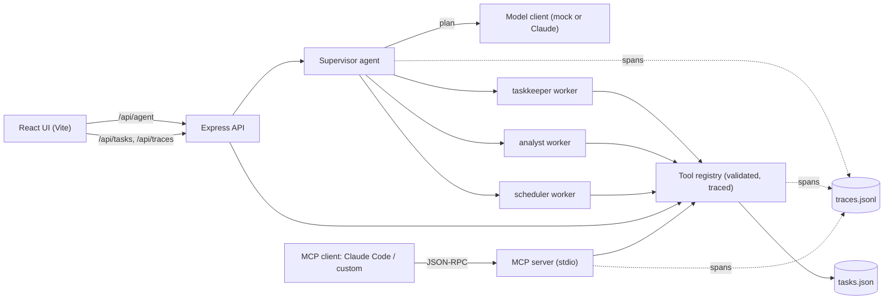

# TaskPilot

A task manager you can talk to. A **supervisor agent** reads a request, routes each part to a specialist **worker agent**, and every agent, model and tool call is **traced** and shown in a waterfall in the UI. The same tools are exposed through a custom **MCP server**, so Claude Code (or any MCP client) can use the app too.

Stack: JavaScript (ESM), HTML, CSS, React (Vite), Express.js, Node 20+.

## Architecture



## Quick start

```bash
npm run install:all
npm run smoke          # end-to-end check on mock data (no API key, no network)
npm run dev:server     # API on http://localhost:4000
npm run dev:client     # UI on http://localhost:5173
```

Try the agents without the UI:

```bash
npm run agent -- "add write report high priority by tomorrow, then summarize my workload and plan my day"
```

## MCP server

`server/mcp/server.js` speaks MCP (JSON-RPC 2.0, newline-delimited, over stdio).

| Kind | Name | What it does |
| --- | --- | --- |
| Resource | `taskpilot://tasks` | All tasks as JSON |
| Tool | `list_tasks`, `create_task`, `complete_task`, `workload_stats` | Same tools the agents use |

**Custom client:** `npm run mcp:demo` connects `server/mcp/client.js`, lists capabilities, reads the resource, calls a tool, and shows the error for a bad call.

**Claude Code:** the repo ships a `.mcp.json`. From the repo root run `claude`, approve the `taskpilot` server, then ask: "Use the taskpilot tools to add a task called 'try MCP' and show my open tasks."

Design choices: tool failures come back as `isError` results (so the model can read and fix its call); unknown tools and resources are protocol errors; stdout carries only protocol messages and logs go to stderr.

## Agents

- **Supervisor** (`agents/supervisor.js`) asks the model client for a plan, runs each step with the right worker, catches a failing worker without losing the others, and joins the replies.
- **Workers** (`agents/workers.js`): `taskkeeper` (create/complete), `analyst` (counts and lists), `scheduler` (what to do next). Each has a narrow job and only acts through tools.
- **Tools** (`tools/registry.js`): one definition per tool with a JSON schema. Arguments are validated before the handler runs, and errors say what was expected, e.g. `create_task: missing required argument "title". Expected { title: string, priority?: low|medium|high, due?: string }.`

## Tracing

`tracer.js` wraps work in `span({ kind, name, input }, fn)`. Spans nest automatically (AsyncLocalStorage), record input, output, error and duration, and append to `server/data/traces.jsonl`. The API, CLI and MCP server all write to it, so one tool call is visible no matter who triggered it. `GET /api/traces` lists runs; `GET /api/traces/:runId` returns a run's spans, which the UI draws as a waterfall.

## Model selection rationale

- **Default: mock planner.** Deterministic, free, offline. It makes the smoke test and demos reliable.
- **Live mode** (set `ANTHROPIC_API_KEY`): the supervisor sends one routing request to `claude-haiku-5-5` (override with `ANTHROPIC_MODEL`). Routing is short classification with structured output, so the smallest fast model is the right trade-off between cost and latency.
- **Guardrail:** the reply must parse as JSON and pass `validatePlan` (known workers, at most 5 steps, non-empty instructions). Otherwise the supervisor falls back to the mock planner and records why in the trace.
- **Where tokens go:** one model call per request. Workers are plain code calling tools, so cost does not grow with the number of workers. Move a worker to an LLM only when it needs judgment.

## Project layout

```
server/
  src/  app.js index.js store.js tracer.js
        routes/ (tasks, agent, traces)  tools/registry.js
        agents/ (modelClient, supervisor, workers)
  mcp/  server.js client.js demo.js
  scripts/ cli.js smoke.js
client/ src/ (App, api, components/, styles.css)
docs/   architecture.mmd
```

## API

| Method | Path | Notes |
| --- | --- | --- |
| GET | `/api/health` | |
| GET/POST | `/api/tasks` | `?status=open|done`; POST body `{ title, priority?, due? }` |
| GET/PATCH/DELETE | `/api/tasks/:id` | |
| POST | `/api/agent` | `{ request }` returns `{ runId, reply, plan, results }` |
| GET | `/api/traces`, `/api/traces/:runId` | |

## Phase 3 checklist

- [x] Custom MCP server: one resource, plus tools
- [x] Connected to a client: custom client and Claude Code (`.mcp.json`)
- [x] Supervisor + 3 workers
- [x] Tracing across the agent graph and MCP calls
- [x] Scaffold runs end-to-end on mock data (`npm run smoke`)
- [ ] Proposal approved by mentor (`PROPOSAL.md` is the draft)
